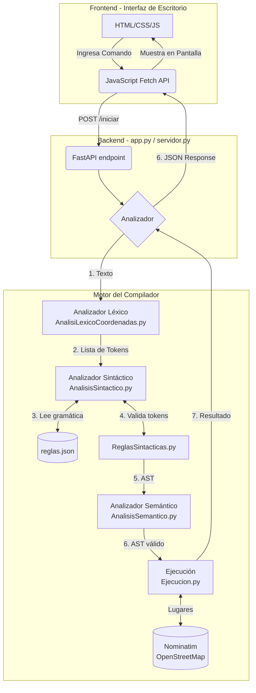

# GeoQuery - Compilador de Coordenadas Geográficas

Este documento proporciona un resumen detallado del proyecto, abordando sus motivaciones, la pila tecnológica utilizada, la arquitectura del sistema, diagramas explicativos y los resultados obtenidos hasta el momento.

## 1. Background (Contexto del Proyecto)

Este proyecto académico nace de la asignatura de **Lenguajes Formales y Compiladores** (Universidad Pedagógica y Tecnológica de Colombia - UPTC). 

El objetivo principal es diseñar e implementar un **Lenguaje de Dominio Específico (DSL)** llamado **GeoQuery**, enfocado exclusivamente en el procesamiento de coordenadas geográficas. En aplicaciones del mundo real (sistemas de información geográfica, navegación, meteorología), manipular estos datos con lenguajes de propósito general requiere crear funciones repetitivas. GeoQuery abstrae esa complejidad ofreciendo instrucciones nativas y semánticamente ricas para:
- Validar rangos geográficos.
- Consultar ubicaciones a partir de coordenadas.
- Calcular distancias entre dos puntos.
- Identificar los hemisferios de coordenadas dadas.

## 2. Tecnologías Utilizadas

El sistema fue construido utilizando tecnologías modernas y ligeras, apostando por un bajo acoplamiento y alta cohesión:

### Lenguaje Principal y Motor
* **Python 3.x:** Utilizado para la creación del motor del compilador (análisis léxico, sintáctico y semántico, y ejecución). Se optó por construirlo desde cero (sin herramientas como PLY o ANTLR) para comprender internamente la teoría de autómatas y gramáticas.

### Backend y Orquestador
* **FastAPI:** Expone el motor del compilador como un servicio web REST local, proveyendo endpoints para que la interfaz gráfica se comunique.
* **Uvicorn:** Servidor ASGI para correr FastAPI.
* **pywebview:** Librería multiplataforma que levanta una ventana de aplicación nativa (Escritorio) y renderiza contenido web dentro de ella, actuando como un puente entre el escritorio y el servidor web local.
* **PyInstaller:** Se utiliza para empaquetar toda la aplicación (Python + HTML/JS/CSS) en un único archivo ejecutable (`.exe`) para Windows.

### Frontend (Interfaz Gráfica)
* **HTML5 / CSS3:** Maquetación de la interfaz con un tema oscuro de editor de código.
* **JavaScript (Vanilla):** Maneja la lógica de la UI y las peticiones (fetch) al backend FastAPI.
* **d3 + topojson-client:** Mapa mundial vectorial (datos de Natural Earth) donde se dibujan los puntos, las rutas y los lugares encontrados.

### Servicios Externos
* **Nominatim (OpenStreetMap):** Búsqueda de lugares por nombre (`UBICACION`) y del lugar que corresponde a una coordenada (`COORDENADA`).

## 3. Arquitectura del Sistema

La arquitectura sigue un patrón altamente modular que separa claramente las fases clásicas de un compilador y las aísla de las interfaces de usuario (CLI y UI).

1. **Interfaz de Entrada (CLI / GUI):** El usuario ingresa sentencias de código (`.geo` o interactivo). Si es la App de Escritorio, la solicitud viaja mediante HTTP al backend.
2. **Analizador Léxico (Lexer):** Recibe la cadena de texto y aplica autómatas finitos (implementados en código) para transformar los caracteres en una lista de **Tokens** (Identificadores, Números, Comas, Paréntesis, etc.). Desecha espacios y comentarios.
3. **Analizador Sintáctico (Parser):** Recibe la lista de Tokens. Utiliza un motor dinámico configurado a través de persistencia (`reglas.json`). Verifica que la estructura de los tokens cumpla con la gramática definida.
4. **Reglas Sintácticas:** Funciones específicas (`ReglasSintacticas.py`) que consumen los tokens para extraer los argumentos (latitud, longitud, cadenas de texto) y construir un Árbol de Sintaxis Abstracta (AST) simplificado en forma de diccionario (comando y argumentos).
5. **Analizador Semántico:** (`AnalisisSemantico.py`) Verifica que los valores tengan sentido geográfico: latitud entre -90 y 90 y longitud entre -180 y 180.
6. **Ejecución:** (`Ejecucion.py`) Calcula el resultado de cada instrucción: distancia con la fórmula de Haversine, hemisferios, validez de la coordenada y consultas de lugares a Nominatim (`ServicioGeografico.py`).
7. **Salida:** `Compilador.py` orquesta las fases para cada línea del programa y devuelve, por instrucción, los tokens, el AST, el resultado o el error con la fase en la que ocurrió.

## 4. Diagrama de Arquitectura

El siguiente diagrama muestra el flujo completo de la información desde la aplicación de escritorio hasta el motor de compilación:

*(Adicionalmente, en la carpeta `imagenes/` del proyecto se encuentran los diagramas de autómatas finitos que representan las transiciones teóricas de cada comando).*

## 5. Resultados Obtenidos

A la fecha, el desarrollo ha arrojado los siguientes resultados concretos:

* **Motor Léxico Robusto:** Se logró construir un lexer capaz de identificar números enteros, decimales, negativos y cadenas de texto, mitigando errores comunes de digitación.
* **Parser Dinámico (Data-Driven):** En lugar de "quemar" (hardcode) las reglas en el código Python, el parser lee la gramática de un archivo `reglas.json`. Esto permite escalar el lenguaje agregando nuevos comandos sin tener que reescribir la clase del parser.
* **Soporte CLI y Scripting:** El compilador puede interactuar desde la consola y también ejecutar scripts con extensión `.geo`.
* **Interfaz de Escritorio Integrada:** Se acopló exitosamente una interfaz moderna sin modificar el motor del compilador. Funciona como un binario instalable (`.exe`) independiente de la consola.
* **Manejo de Errores Descriptivo:** El sistema identifica claramente en qué fase (léxica, sintáctica, semántica o de ejecución) falla el código del usuario y en qué línea ocurrió el problema, sin detener el análisis de las demás líneas.
* **Análisis Semántico e Intérprete:** Las cinco instrucciones se ejecutan: validación de rangos, distancia con la fórmula de Haversine, hemisferios y geocodificación (directa e inversa) con Nominatim.
* **Mapa Interactivo:** Los resultados se dibujan en un mapa mundial (puntos, rutas con su distancia y lugares encontrados).
* **Despliegue y Calidad:** La aplicación se publica en línea con Docker y Render, y cuenta con pruebas automáticas (pytest) que se ejecutan en GitHub Actions en cada pull request.
